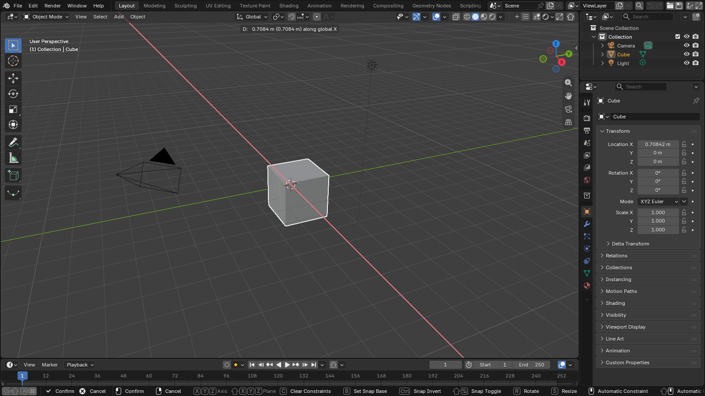

# Blender 5.3 for Windows — Tablet UX

A Windows (desktop) build of **Blender 5.3.0** with touch and pen friendly UX, implementing
the items of Blender's *"Blender on Tablet: Path to Release"* plan (code.blender.org,
November 2026) that are feasible on top of the existing desktop UI. Upstream, these are still
open design tasks without code, so this is an independent implementation.

Useful for Windows tablets / 2-in-1s (Surface, …), pen displays (Wacom Cintiq / MovinkPad) and
anyone who wants to work without a keyboard.



*Move (G) after tapping the **X** hint in the status bar: docked modifier keys, Confirm /
Cancel and clickable key hints in the status bar; tablet buttons in the header and top bar.*

- Patch: [patches/tablet-ux-blender-5.3.patch](patches/tablet-ux-blender-5.3.patch)
  (applies to tag `v5.3.0` / branch `blender-v5.3-release`)
- Build script: [build_windows.ps1](build_windows.ps1)
- Tests: [tests/](tests/)

## What it adds

| Plan item | Implementation |
|---|---|
| **Modifier Wheel** (#165901) | Window-manager "sticky" modifiers: Ctrl / Shift / Alt / OS held from the screen. Tap = one-shot (applies to the next click or key, then releases), tap again = locked, again = off. Available as a pie menu (`WM_MT_tablet_modifier_wheel`) and docked at the start of the status bar. Modifiers are added to events when they are handled and never written into the real keyboard state, so they can't get stuck. API: `wm.sticky_modifier_toggle`, `wm.sticky_modifier_clear`, `WindowManager.sticky_modifiers(_locked)`. |
| **Clickable status bar** (#165900) | While a modal tool runs (Move, Rotate, Scale, Knife, …) the status bar shows **Confirm / Cancel**, and every key hint (X / Y / Z, Shift, B, …) is a button that presses that key for the tool (`wm.status_key_press`). Mouse input that starts on the status bar goes to it instead of the running tool. |
| **Top level search** (#165902) | Search button in the top bar: searches the menus of the main 3D Viewport (or largest editor) from anywhere. |
| **On-screen keyboard** (#165899) | Top bar button opening the Windows touch keyboard (TabTip, falls back to OSK). |
| **Portfolio Review** (#166024) | 3D Viewport header: View pie, *Display* popover (shading + overlays in one place), Focus (hide UI), Search; top bar Open. |
| **Scene Assembly** (#166529) | 3D Viewport header: **+** (Add menu of the current mode), context menu button (same as right-click); top bar Undo / Redo, Save. |
| **Sculpting** (#166714) | *Sculpt* popover: radius, strength, voxel remesh, dynamic topology. |
| **Responsive UI / touch targets** | Top bar toggle for a touch sized interface (UI scale, default 1.3). |

The Python UI is a core add-on, **Tablet UX** (`scripts/addons_core/tablet_ux`), enabled in the
factory preferences, with options in *Preferences → Add-ons → Tablet UX*. If you already had
Blender 5.3 preferences, enable it there once.

Not implemented (no upstream code, large projects): the responsive *Compact UI*, gesture
editing, desktop hand-off.

## Build

```powershell
.\desktop\build_windows.ps1            # source + libraries in C:\blender-git
```

First build ≈ 1 h on 8 cores; afterwards `make.bat 2022b ninja nobuildinfo` in
`C:\blender-git\blender` rebuilds incrementally.

## Tests

```powershell
$bl = "C:\blender-git\build_windows_x64_vc17_Release\bin\blender.exe"
& $bl --background --factory-startup --python desktop\tests\verify_tablet.py      # API + add-on (23 checks)
& $bl --factory-startup --enable-event-simulate --python desktop\tests\sim_tablet.py # sticky modifiers, status bar keys
& $bl --factory-startup --enable-event-simulate --window-geometry 0 0 1600 900 --python desktop\tests\sim_click.py  # real status bar clicks
```

`sim_click.py` clicks fixed status bar positions measured for a 1600×900 window at the default
UI scale.
